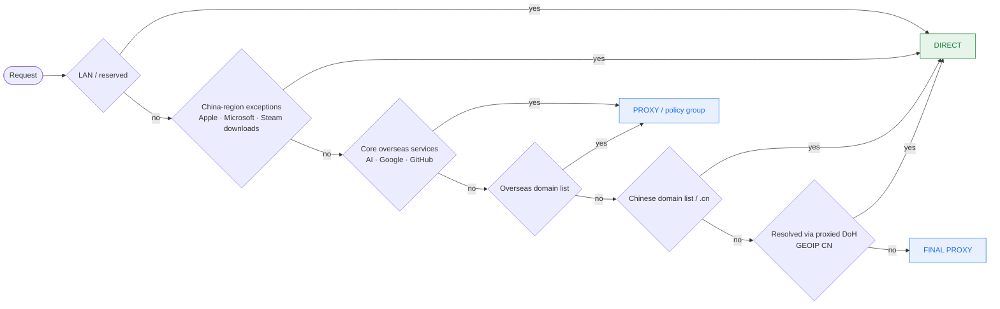

<div align="center">

# Shadowrocket CN Smart

**A precise, leak-resistant Shadowrocket profile for mainland China**

Domestic direct · Overseas proxied · DNS encrypted end to end

[](https://github.com/ailuckly/shadowrocket-cn-smart/releases/latest)
[](https://github.com/ailuckly/shadowrocket-cn-smart/actions/workflows/check.yml)
[](https://github.com/ailuckly/shadowrocket-cn-smart/commits/main)
[](https://github.com/ailuckly/shadowrocket-cn-smart/stargazers)
[](LICENSE)

[简体中文](README.md) · **English**

</div>

<br>

<div align="center">

| 33,000+ | 4 | 26 | 4 | Weekly |
| :---: | :---: | :---: | :---: | :---: |
| cleaned domain rules | editions | policy groups | optional modules | upstream sync |

</div>

## Features

- **Precise routing**: China-region iCloud, App Store downloads, Apple Pay, Maps, 21Vianet / Azure China, Windows Update and Steam downloads go direct; global Apple, Microsoft, Google and AI services go through the proxy.
- **DNS leak protection**: default DoH is sent through the proxy, domestic domains use domestic DoH, and node hostnames have a separate bootstrap resolver; port 53 is hijacked and QUIC is blocked for proxied traffic.
- **Cleaned data**: IP-check sites, overseas app variants and private trackers wrongly listed as Chinese upstream are removed; rule conflicts fail the build.
- **Two forms**: offline editions embed every rule in one file; online editions inline fewer than 200 rules and load large lists via `DOMAIN-SET` for a smaller memory footprint.
- **Verifiable**: all four editions are built from the same sources, and offline regression tests confirm they route identically.

## Editions

| Edition | Size | Notes |
| --- | --- | --- |
| [**Online**](https://raw.githubusercontent.com/ailuckly/shadowrocket-cn-smart/main/dist/Shadowrocket-CN-Smart-Online.conf) · recommended | 10 KB | Lowest memory, rules update with the repository |
| [Group-Online](https://raw.githubusercontent.com/ailuckly/shadowrocket-cn-smart/main/dist/Shadowrocket-CN-Smart-Group-Online.conf) | 16 KB | Adds 26 policy groups for per-service node selection |
| [Offline](https://raw.githubusercontent.com/ailuckly/shadowrocket-cn-smart/main/dist/Shadowrocket-CN-Smart-Offline.conf) | 1.15 MB | All rules embedded, no remote dependencies |
| [Group-Offline](https://raw.githubusercontent.com/ailuckly/shadowrocket-cn-smart/main/dist/Shadowrocket-CN-Smart-Group-Offline.conf) | 1.15 MB | Offline plus 26 policy groups |

## Quick start

1. Copy a link above, paste it in Shadowrocket under **Config → `+`**, then select **Use Config**.
2. Pick a node on the home screen and set **Global Routing** to **Config**.
3. Enable **Disable STUN** in settings, then connect.

> [!IMPORTANT]
> Global Routing must be set to **Config**. Choosing Proxy or Direct bypasses every rule.

> [!TIP]
> Open **Request Log**: `www.10086.cn` should show `DIRECT` and `www.google.com` should show `PROXY`.

## Routing order



## Modules

Add them under **Config → Modules → `+`**. Enabled modules survive main profile updates.

| Module | Certificate | Purpose |
| --- | :---: | --- |
| [`adblock-dns`](https://raw.githubusercontent.com/ailuckly/shadowrocket-cn-smart/main/modules/adblock-dns.module) | — | Domain-level blocking of ad networks, mobile ad SDKs and trackers |
| [`adblock-mitm`](https://raw.githubusercontent.com/ailuckly/shadowrocket-cn-smart/main/modules/adblock-mitm.module) | Self-signed, local | Rewrites splash-ad APIs of Bilibili, Zhihu and Weibo |
| [`block-httpdns`](https://raw.githubusercontent.com/ailuckly/shadowrocket-cn-smart/main/modules/block-httpdns.module) | — | Blocks common HttpDNS so apps fall back to standard DNS |
| [`corporate-vpn-template`](https://raw.githubusercontent.com/ailuckly/shadowrocket-cn-smart/main/modules/corporate-vpn-template.module) | — | Coexist with a corporate VPN on macOS |

## Known limitations

- Unlisted domains fall back to `GEOIP,CN`. Because DoH answers reflect the node's location, Chinese sites that also have overseas CDNs may be proxied. Issues are welcome.
- Captive-portal Wi-Fi may not show its login page; pause Shadowrocket, sign in, then reconnect.
- iOS allows only one active VPN, so a corporate VPN will disconnect Shadowrocket.

<details>
<summary><b>Updates</b></summary>

<br>

- **Online**: profile and rules are read from the `main` branch. Upstream is synced every Monday into a reviewed PR; refresh in the app after it is merged.
- **Offline**: larger changes ship as a new [release](https://github.com/ailuckly/shadowrocket-cn-smart/releases); download and re-import.
- **Legacy link**: `Shadowrocket-CN-Smart.conf` in each release mirrors the Offline edition, so v1.x links keep updating.

</details>

<details>
<summary><b>Build locally</b></summary>

<br>

Python 3.9+, no third-party dependencies.

```sh
python3 scripts/build.py                     # generate rules/ and dist/ from config/ and data/
python3 scripts/build.py --check             # verify generated files are current
python3 -m unittest discover -s tests        # offline regression tests
python3 scripts/sync_upstream.py             # refresh upstream snapshots
python3 scripts/build.py --profile host-conf/profile.json   # build a private overlay
```

`host-conf/` is git-ignored and holds private data such as corporate VPN gateways and intranet hosts.

</details>

## Sources & License

| Source | Usage | License |
| --- | --- | --- |
| [MetaCubeX/meta-rules-dat](https://github.com/MetaCubeX/meta-rules-dat) | Chinese, overseas, Apple and Microsoft domain snapshots | GPL-3.0 |
| [blackmatrix7/ios_rule_script](https://github.com/blackmatrix7/ios_rule_script) | Referenced via MetaCubeX geo-lite | [GPL-2.0](data/LICENSES/blackmatrix7-GPL-2.0.txt) |
| [v2fly/domain-list-community](https://github.com/v2fly/domain-list-community) | Upstream domain categories | [MIT](data/LICENSES/v2fly-MIT.txt) |

Original templates, modules, scripts and docs are released under [GPL-3.0](LICENSE); upstream data keeps its original attribution and license. This project ships routing rules and modules only, contains no nodes, subscriptions or certificates, and is not affiliated with Shadowrocket.

<div align="center">

<br>

[](https://star-history.com/#ailuckly/shadowrocket-cn-smart&Date)

<sub>If it helps you, a ⭐ is appreciated.</sub>

</div>
