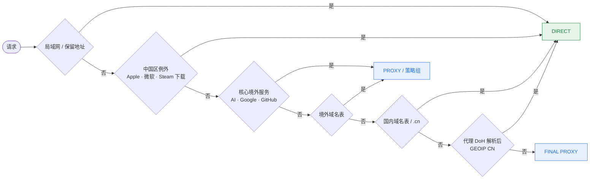

<div align="center">

# Shadowrocket CN Smart

**为中国大陆设计的 Shadowrocket 分流配置**

国内直连 · 境外代理 · DNS 全程加密

[](https://github.com/ailuckly/shadowrocket-cn-smart/releases/latest)
[](https://github.com/ailuckly/shadowrocket-cn-smart/actions/workflows/check.yml)
[](https://github.com/ailuckly/shadowrocket-cn-smart/commits/main)
[](https://github.com/ailuckly/shadowrocket-cn-smart/stargazers)
[](LICENSE)

**简体中文** · [English](README.en.md)

</div>

<br>

<div align="center">

| 33,000+ | 4 | 26 | 4 | 每周 |
| :---: | :---: | :---: | :---: | :---: |
| 清洗后的域名规则 | 发行版本 | 策略组 | 可选模块 | 上游同步 |

</div>

## 特性

- **精细分流**：中国区 iCloud、App Store 下载、Apple Pay、地图、世纪互联与 Azure 中国、Windows 更新、Steam 下载直连；全球 Apple、Microsoft、Google 与 AI 服务走代理。
- **DNS 防泄露**：默认 DoH 经代理发出，国内域名使用国内 DoH，节点域名单独引导解析；劫持 53 端口，代理流量禁用 QUIC。
- **数据清洗**：剔除上游混入国内列表的查 IP 站、海外版应用与 PT 站；规则冲突在构建时直接报错。
- **两种形态**：离线版单文件内置全部规则；在线版内联不到 200 条，大表通过 `DOMAIN-SET` 加载，内存占用更低。
- **可验证**：四个版本由同一套源文件构建，离线回归测试逐一比对，分流结果完全一致。

## 版本

| 版本 | 体积 | 说明 | 链接 |
| --- | --- | --- | --- |
| **在线版** · 推荐 | 10 KB | 内存占用最低，规则随仓库更新 | [Online](https://raw.githubusercontent.com/ailuckly/shadowrocket-cn-smart/main/dist/Shadowrocket-CN-Smart-Online.conf) |
| 在线策略组版 | 16 KB | 另含 26 个策略组，可为 AI、流媒体等单独选节点 | [Group-Online](https://raw.githubusercontent.com/ailuckly/shadowrocket-cn-smart/main/dist/Shadowrocket-CN-Smart-Group-Online.conf) |
| 离线版 | 1.15 MB | 规则全部内置，无远程依赖 | [Offline](https://raw.githubusercontent.com/ailuckly/shadowrocket-cn-smart/main/dist/Shadowrocket-CN-Smart-Offline.conf) |
| 离线策略组版 | 1.15 MB | 离线 + 26 个策略组 | [Group-Offline](https://raw.githubusercontent.com/ailuckly/shadowrocket-cn-smart/main/dist/Shadowrocket-CN-Smart-Group-Offline.conf) |

<sub>文件名依次为 `Shadowrocket-CN-Smart-Online.conf`、`Shadowrocket-CN-Smart-Group-Online.conf`、`Shadowrocket-CN-Smart-Offline.conf`、`Shadowrocket-CN-Smart-Group-Offline.conf`。策略组版导入后，除哔哩哔哩默认直连外，其余分组都跟随首页节点。</sub>

## 快速开始

1. 复制上表中的链接，在 Shadowrocket **配置 → `+`** 中粘贴下载，点击该配置选择 **使用配置**。
2. 回到首页选择节点，将 **全局路由** 设为 **配置**。
3. 在设置中开启 **禁用 STUN**，然后连接。

> [!IMPORTANT]
> 全局路由必须是 **配置**（配置模式），选「代理」或「直连」会让全部规则失效。

> [!TIP]
> 打开 **请求日志**，访问 `www.10086.cn` 应显示 `DIRECT`，访问 `www.google.com` 应显示 `PROXY`，即说明分流生效。完整图文步骤见 [导入指南](docs/README.md)。

## 分流顺序



## 模块

在 **配置 → 模块 → `+`** 中按需添加，主配置更新不会影响已启用的模块。

| 模块 | 证书 | 用途 |
| --- | :---: | --- |
| [`adblock-dns`](https://raw.githubusercontent.com/ailuckly/shadowrocket-cn-smart/main/modules/adblock-dns.module) | — | 域名级拦截广告联盟、移动广告 SDK 与追踪域名 |
| [`adblock-mitm`](https://raw.githubusercontent.com/ailuckly/shadowrocket-cn-smart/main/modules/adblock-mitm.module) | 本机自签 | 改写 B站、知乎、微博的开屏广告接口，见[说明](docs/modules.md) |
| [`block-httpdns`](https://raw.githubusercontent.com/ailuckly/shadowrocket-cn-smart/main/modules/block-httpdns.module) | — | 拦截常见 HttpDNS，让 App 回到标准 DNS |
| [`corporate-vpn-template`](https://raw.githubusercontent.com/ailuckly/shadowrocket-cn-smart/main/modules/corporate-vpn-template.module) | — | macOS 上与企业 VPN 共存，见[指南](docs/corporate-vpn.md) |

## 已知限制

- 未收录的域名由 `GEOIP,CN` 兜底。境外 DoH 按节点位置返回结果，同时有海外 CDN 的国内网站可能走代理，欢迎提 Issue 补充。
- 需要网页认证的公共 Wi-Fi 可能无法弹出认证页，先暂停 Shadowrocket 完成认证即可。
- iOS 同一时间只允许一个 VPN，开启企业 VPN 会断开 Shadowrocket。

<details>
<summary><b>更新方式</b></summary>

<br>

- **在线版**：配置与规则都从本仓库 `main` 分支读取。上游每周一自动同步并生成 PR，审核合并后在 App 内刷新即可。
- **离线版**：较大的改动会发布新版本，在 [Releases](https://github.com/ailuckly/shadowrocket-cn-smart/releases) 下载后重新导入。
- **旧链接**：Release 中的 `Shadowrocket-CN-Smart.conf` 与离线版内容一致，v1.x 的固定链接可以继续更新。

</details>

<details>
<summary><b>本地构建</b></summary>

<br>

需要 Python 3.9+，无第三方依赖。

```sh
python3 scripts/build.py                     # 由 config/ 与 data/ 生成 rules/ 与 dist/
python3 scripts/build.py --check             # 校验生成文件是否最新
python3 -m unittest discover -s tests        # 离线回归测试
python3 scripts/sync_upstream.py             # 同步上游快照
python3 scripts/build.py --profile host-conf/profile.json   # 生成本机私有配置
```

`host-conf/` 已被 Git 忽略，用于存放公司 VPN、内网域名等私有信息。

</details>

<details>
<summary><b>目录结构</b></summary>

<br>

```text
config/     源配置：General、策略组、分段规则、服务列表、清洗规则
data/       锁定 SHA-256 的上游域名快照
scripts/    构建与上游同步脚本
rules/      生成的 DOMAIN-SET 与服务 RULE-SET（在线版读取）
dist/       生成的四个配置文件
modules/    可选模块
tests/      离线回归测试
docs/       导入指南、模块说明、企业 VPN 指南
```

</details>

## 规则来源与许可

| 来源 | 用途 | 许可 |
| --- | --- | --- |
| [MetaCubeX/meta-rules-dat](https://github.com/MetaCubeX/meta-rules-dat) | 国内、境外、Apple、Microsoft 域名快照 | GPL-3.0 |
| [blackmatrix7/ios_rule_script](https://github.com/blackmatrix7/ios_rule_script) | 经 MetaCubeX geo-lite 引用 | [GPL-2.0](data/LICENSES/blackmatrix7-GPL-2.0.txt) |
| [v2fly/domain-list-community](https://github.com/v2fly/domain-list-community) | 上游域名分类 | [MIT](data/LICENSES/v2fly-MIT.txt) |

项目自身的模板、模块、脚本与文档以 [GPL-3.0](LICENSE) 发布，上游数据保留原始署名与许可。本项目只提供分流规则与模块，不含任何节点、订阅或证书，与 Shadowrocket 官方无关。提交 Issue 或截图时请隐去节点、订阅与内网地址。

<div align="center">

<br>

[](https://star-history.com/#ailuckly/shadowrocket-cn-smart&Date)

<sub>如果它对你有帮助，欢迎点一个 ⭐</sub>

</div>
