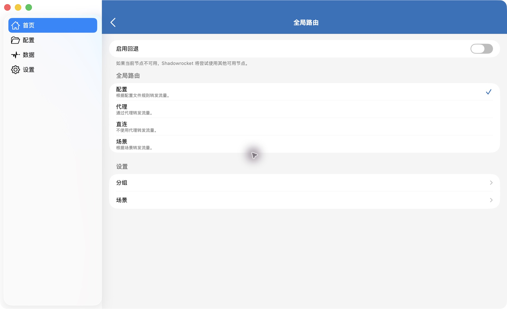

# 🚀 Shadowrocket CN Smart · 三步导入指南

**一个配置文件，让流量各走其路。**

面向中国大陆日常网络的 Shadowrocket（小火箭）分流配置：国内服务优先直连，境外服务使用你选择的节点。规则已内置，无需运行脚本或安装证书。

[⬇ 下载配置文件](https://github.com/ailuckly/shadowrocket-cn-smart/releases/download/v1.0.1/Shadowrocket-CN-Smart-v1.0.1.conf) · [返回项目首页](../README.md)

> **开始前：**需要已安装的 Shadowrocket 和自己的可用节点。本项目只提供分流规则，不提供节点、订阅或服务器账号。
>
> 本教程以 **macOS 上的 Shadowrocket 2.2.92** 界面为例，配置版本为 **v1.0.1**。其他系统或客户端版本的入口可能不同。

## 01 · 下载 .conf 文件

点击上方下载链接，将文件保存到本地。也可以从 [Release 页面](https://github.com/ailuckly/shadowrocket-cn-smart/releases/tag/v1.0.1) 下载同名附件：

```text
Shadowrocket-CN-Smart-v1.0.1.conf
```

文件约 1.2 MB，规则已内置。普通用户只需要这个文件，无需下载整个仓库或 Source code 压缩包。保存后确认扩展名是 `.conf`，而不是 `.txt` 或 `.html`。

## 02 · 导入，并启用配置

1. 在 Shadowrocket 左侧进入 **配置**。
2. 点击 **导入…**，选择刚下载的 `.conf` 文件。
3. 导入后，将该文件设为当前使用的配置。
4. 在「本地文件」中核对文件名和版本。

**复选标记代表正在使用的配置。** 文件出现在列表里，并不等于已经启用。

## 03 · 选择「配置」模式，再连接节点

1. 回到 **首页**，选择自己的可用节点。
2. 打开 **全局路由**，选择 **配置**。
3. 确认连接已开启，再开始访问网站。



*界面示例 · Shadowrocket 2.2.92 / macOS。请选择「配置」模式，其余开关可按需设置。*

> **关键区别：**「配置」按文件规则分流；「代理」不是本教程使用的分流模式。
>
> 本文件的 `PROXY` 使用首页节点，不附带自动选择节点的策略组。若应用另有回退设置，节点故障时的切换行为还受该设置影响。

## 导入后，核对这几件事

- [ ] 正在使用的配置版本与下载版本一致。
- [ ] 全局路由显示「配置」，不是「代理」或「直连」。
- [ ] 首页已选中可用节点，连接已开启。
- [ ] 已打开「禁用 STUN」。这个开关不在配置文件里，文件也不会伪造 STUN 应答。
- [ ] 系统和浏览器没有另外指定 DNS。本文件接管 53 端口上的查询。

完成以上设置后，即可按下表使用分流配置：

| 流量类型 | 本版本的预期策略 |
| --- | --- |
| 本地网络、已收录国内域名、未被更早规则命中的 `.cn` | `DIRECT`：使用本地直连网络 |
| 已收录境外 AI、Google 与开发平台 | `PROXY`：使用首页节点 |
| Apple、Microsoft 的全球服务 | `PROXY`：使用首页节点 |
| Apple 推送、校时、证书检查；中国区 iCloud、App Store、世纪互联与 Azure 中国 | `DIRECT` |
| 未命中前置规则的流量 | 已有 CN 目标 IP 按 GeoIP 直连，其余代理兜底 |

## 在日志里核对

导入后打开 Shadowrocket 的请求日志，访问下面的地址，看命中的策略。日志里的结果优先于页面是否打开：节点不通时，代理目标打不开是节点问题，直连目标仍应标为 `DIRECT`。

| 访问 | 日志里应看到 |
| --- | --- |
| `www.10086.cn`、一篇带图片的微信文章 | `DIRECT`，图片域名常见为 `qpic.cn` |
| `www.icloud.com` | `PROXY` |
| `www.icloud.com.cn`、`www.apple.com.cn` | `DIRECT` |
| 让一台 Apple 设备收到一条通知 | `courier.push.apple.com` 或 `*.push.apple.com` 为 `DIRECT` |
| `www.google.com`、`github.com` | `PROXY` |

蜂窝网络下再看一次本地网关。地址落在 `100.64.0.0/10` 时，日志不应把它送进首页节点。国内网站打开后，连接地址应是中国大陆地址，而不是节点所在地的地址。

## 使用与更新

**更新方式：**下载新版本文件，重新导入并确认启用。建议先保留上一版本，方便需要时切回。离线规则不会自动获取上游更新，规则更新随项目版本发布。

当前为 **v1.0.1**，适用于具备 IPv4 连接的网络。配置负责流量分流：境外流量使用首页节点，代理流量的 QUIC 会关闭并改走 TCP，国内直连仍可使用 QUIC。节点的网络类型、系统语言和时区不由本文件改变。请自行准备可用节点；目标服务的地区及账号要求由对应服务商决定。

## 反馈与贡献

使用中遇到问题或发现域名遗漏，欢迎 [提交 Issue](https://github.com/ailuckly/shadowrocket-cn-smart/issues/new)，提供配置版本、Shadowrocket 版本、目标域名、实际表现和期望策略。

欢迎 Fork 项目并 [提交 PR](https://github.com/ailuckly/shadowrocket-cn-smart/pulls)，补充规则、改进说明或分享更清晰的使用教程。**请勿公开订阅链接、密码或完整访问日志。**

---

教程更新：2026-10-25。独立社区项目，与 Shadowrocket 官方无隶属关系。

另附 [HTML 排版版](index.html)：与 `images` 目录一起保存后，可在浏览器中打开；GitHub 文件页仅显示 HTML 源码。
