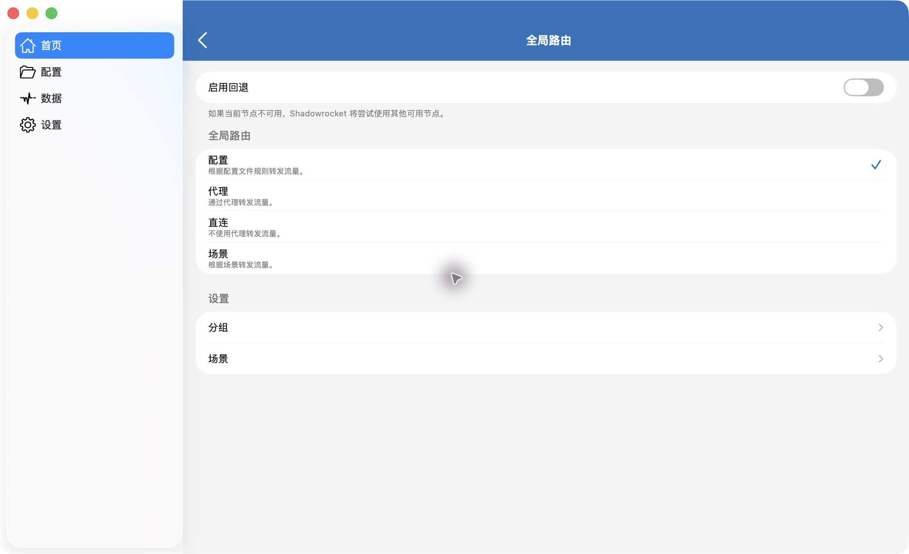

# 导入指南

[项目首页](../README.md) · [模块与证书](modules.md) · [企业 VPN 共存](corporate-vpn.md)

开始前需要已安装 Shadowrocket，并有自己的可用节点。

## 1. 选择版本

| 版本 | 文件 | 适合 |
| --- | --- | --- |
| 在线版 · 推荐 | [`Shadowrocket-CN-Smart-Online.conf`](../dist/Shadowrocket-CN-Smart-Online.conf) | 大多数用户，内存占用最低 |
| 在线策略组版 | [`Shadowrocket-CN-Smart-Group-Online.conf`](../dist/Shadowrocket-CN-Smart-Group-Online.conf) | 需要为 AI、流媒体等单独选节点 |
| 离线版 | [`Shadowrocket-CN-Smart-Offline.conf`](../dist/Shadowrocket-CN-Smart-Offline.conf) | 不希望依赖远程规则 |
| 离线策略组版 | [`Shadowrocket-CN-Smart-Group-Offline.conf`](../dist/Shadowrocket-CN-Smart-Group-Offline.conf) | 离线 + 策略组 |

## 2. 导入并启用

1. 复制首页对应的 Raw 链接，在 Shadowrocket **配置 → `+`** 中粘贴下载。
2. 点击下载好的配置，选择 **使用配置**，右侧出现 ✓ 即为启用。
3. 需要去广告或企业 VPN 共存时，在 **配置 → 模块** 中添加对应模块。

## 3. 切换到配置模式

1. 在首页选择节点。
2. 将 **全局路由** 设为 **配置**。
3. 在设置中开启 **禁用 STUN**，然后连接。

## 4. 核对分流

打开 **请求日志**，正常访问以下站点：

| 站点 | 预期 |
| --- | --- |
| `www.10086.cn`、`mmbiz.qpic.cn`、`www.icloud.com.cn`、`iosapps.itunes.apple.com` | `DIRECT` |
| `www.google.com`、`github.com`、`chatgpt.com`、`www.apple.com` | `PROXY` 或对应策略组 |

无需反复访问 IP 检测站点，查看日志即可确认。连接需要网页认证的公共 Wi-Fi 时，如未弹出认证页，先暂停 Shadowrocket，认证完成后再连接。

---

独立开源项目，与 Shadowrocket 官方无关。另有 [HTML 版](index.html)。
